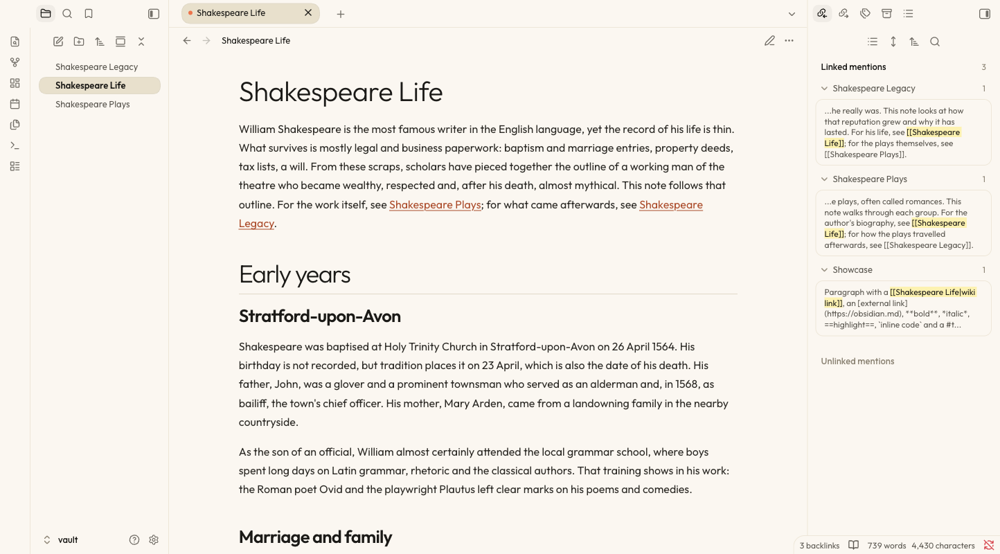
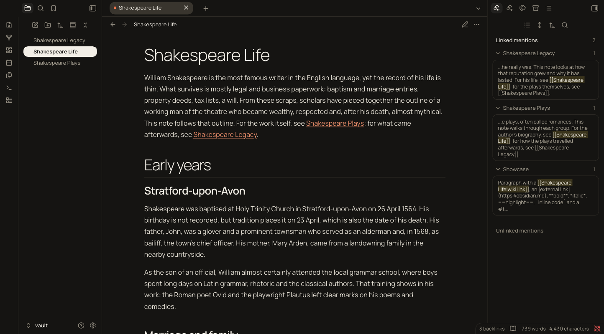

# paper-lite

A warm, editorial theme for [Obsidian](https://obsidian.md): cream paper, ink-dark type, a touch of orange, and serif accents. It comes in two modes, light and dark, and follows Obsidian's own colour-scheme setting.

| Light | Dark |
| --- | --- |
|  |  |

> **Based on [Suliworld](https://github.com/sulistef/obsidian-suliworld)** by Stéphane Sulikowski (MIT licence). paper-lite started as a copy of that theme and is maintained as a separate project. It is not affiliated with the original.

## Features

- **Light and dark, one surface each.** The sidebars, tab bar, vault row, status bar and editor share the same background, separated by hairlines. Light is cream (`#fbf7f0`); dark is near-black (`#151412`).
- **Pill tabs.** The active tab and the selected file row are a warm sand pill in light mode (cream in dark mode), with a small orange dot on the tab.
- **One heading system.** Every level uses the same ink colour and typeface, and the hierarchy comes from size and weight: a large light H1 over a hairline, semi-bold H2 to H4, muted H5, and small-caps H6. Orange is kept for interaction, such as the fold chevron in the margin, which stays visible on a folded heading.
- **Accent titles.** Italic text inside a heading is set in the display serif, in orange: `# Slow software. *Why patience ships better apps*`
- **Callouts.** Tinted by type: note in blue, tip in mint, warning in peach, question in lavender, quote in yellow.
- **Quotes, code and embeds.** Peach blockquotes in the display serif, dark code blocks in iA Writer Duo, and embedded notes shown as a dark green card. Plain alternatives are available in the settings.
- **Bullet journal signifiers** for tasks (see below).
- **Five font pairings**, all bundled, so no network access is needed.
- **Mobile-friendly.** Heading sizes scale down on phones.

## Install

### From the community themes list

Once paper-lite is accepted into Obsidian's community themes, open Settings → Appearance → Themes → Manage, search for **paper-lite**, and choose Install and use.

### Manually

1. Download `theme.css` and `manifest.json` from the [latest release](https://github.com/jrayas/paper-lite/releases/latest).
2. Put both files in a folder called `paper-lite` inside your vault's themes folder: `<Vault>/.obsidian/themes/paper-lite/`.
3. In Obsidian, open Settings → Appearance → Themes and choose **paper-lite**.

## Light and dark mode

Open Settings → Appearance → Base colour scheme and choose Light, Dark, or Adapt to system.

## Settings

Install the [Style Settings](https://github.com/mgmeyers/obsidian-style-settings) plugin to customise the theme. Open Settings → Style Settings → paper-lite:

- **Fonts for light mode and for dark mode:**
  - A · Outfit × Newsreader (light default)
  - B · Manrope × Instrument Serif (dark default)
  - C · Plus Jakarta Sans × Young Serif
  - D · Hanken Grotesk × Gloock
  - E · Albert Sans × DM Mono
- **Side panels (light mode):** Flat (cream, the default) or Sand (one warm step darker than the editor).
- **Floating cards:** never (the default, one continuous surface), dark mode only, or always. Cards are rounded panes with gaps between them.
- **External link icon:** a ↗ arrow in the link colour, none, or Obsidian's default.
- **Drop cap** in reading view.
- **Plain blockquotes** and **plain embeds**, replacing the peach quote box and the dark green embed card.
- **Bullet journal signifiers:** on or off, size, and a symbol and colour for each type.

Without Style Settings, the theme uses the defaults listed above.

## Bullet journal signifiers

The character between a task's brackets picks the symbol shown in place of the checkbox:

| Markdown | Meaning | Default symbol |
| --- | --- | --- |
| `- [ ]` | Task | • |
| `- [x]` | Done | × (struck through) |
| `- [*]` | Event | ✱ orange |
| `- [n]` | Note | ■ green |
| `- [>]` | Migrated | › |
| `- [<]` | Scheduled | ‹ |
| `- [!]` | Important | ! on a peach disc |

Events and notes aren't clickable, so a stray click can't turn them back into tasks. Any other character keeps Obsidian's standard checkbox. This is on by default and can be turned off in the Style Settings.

## Known limitations

- Tested on macOS with Obsidian 1.14.4. Windows, Linux, and mobile have not been tested.
- Canvas and Graph view have only been checked briefly, and the Graph view's link lines are faint in dark mode.
- Some secondary text in light mode, such as "Unlinked mentions", is below the 4.5:1 contrast target.
- The options above need the Style Settings plugin; without it the defaults apply.

## Building from source

`theme.css` is generated. Edit `src/theme.css`, then run:

```bash
./build.sh
```

The script embeds the fonts from `fonts/` as base64, because Obsidian themes can't load font files stored next to them. To build and install into one or more vaults at once:

```bash
./build.sh ~/path/to/vault
```

## Releasing

See [RELEASING.md](RELEASING.md). In short: bump `version` in `manifest.json`, rebuild, commit, then push a tag with the same version, with no `v` in front (for example `0.1.3`). The release workflow attaches `manifest.json` and `theme.css` to a GitHub release.

## Licence

The theme is released under the [MIT Licence](LICENSE). It includes the original copyright of Stéphane Sulikowski and the copyright of the paper-lite changes.

The bundled fonts are licensed under the SIL Open Font Licence 1.1. See [fonts/OFL.txt](fonts/OFL.txt) for their copyright notices: Outfit, Newsreader, Manrope, Instrument Serif, Plus Jakarta Sans, Young Serif, Hanken Grotesk, Gloock, Albert Sans, DM Mono, and iA Writer Duo.
