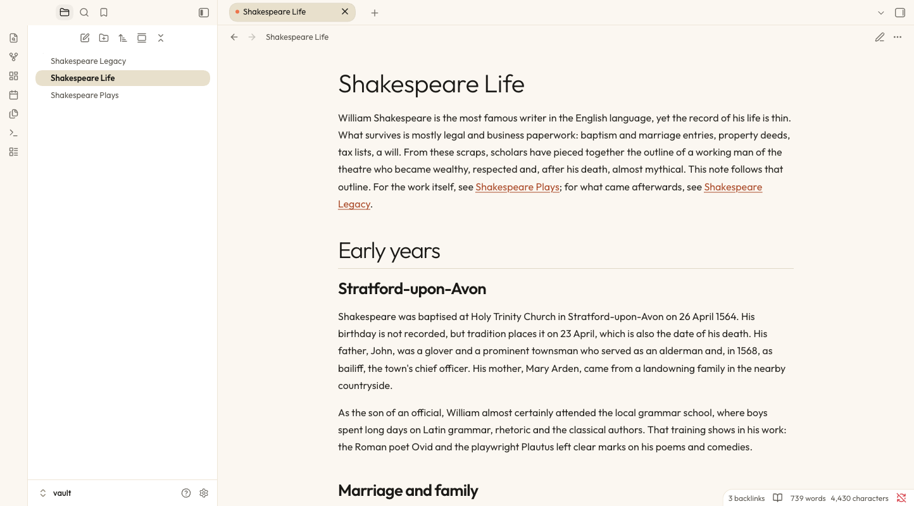
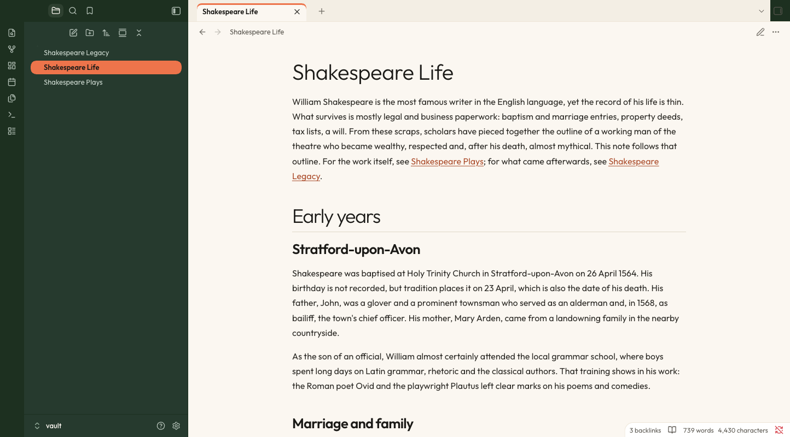

# paper-lite

> **Based on [Suliworld](https://github.com/sulistef/obsidian-suliworld)** by Stéphane Sulikowski (MIT licence). paper-lite started as a copy of that theme and is now maintained as a separate project, not affiliated with the original. Sections below that still say "Suliworld" describe the upstream theme and are updated as paper-lite diverges.

A warm, editorial theme for [Obsidian](https://obsidian.md), based on the design of [suliworld.com](https://www.suliworld.com): cream paper, forest green, a touch of orange, and serif accents.



## Features

- **Two light variants.** *Cream* (white sidebars, warm sand pill tabs and selected rows with a small orange dot) and *Forest* (deep green ribbon and sidebars, orange-underlined tabs).
- **Dark mode with floating cards.** Rounded panes float on a near-black canvas (desktop only).
- **One heading system.** Every level uses the same ink colour and typeface, and the hierarchy comes from size and weight: a large light H1 over a hairline, semi-bold H2 to H4, muted H5, and small-caps H6. Orange is kept for interaction, such as the fold chevron in the margin (always visible on a folded heading).
- **Accent titles.** Italic text inside a heading is set in the display serif, in orange:
  `# Slow software. *Why patience ships better apps*`
- **Tinted callouts.** Note in blue, tip in mint, warning in peach, question in lavender, quote in yellow.
- **Neutral blocks.** A plain-rule blockquote in the display serif, sand code blocks in iA Writer Duo, and one neutral callout card whose bar, icon and title carry the colour (ink, green, rust or red). Embedded notes sit in a hairline frame. The earlier peach quote box and dark-green embed card are optional Style Settings switches.
- **Bullet journal signifiers** for tasks (see below).
- **Five font pairings**, all bundled: no network access is needed.
- **Mobile-friendly.** Heading sizes scale down on phones.

| Forest variant | Dark mode |
| --- | --- |
|  |  |

## Bullet journal signifiers

The character between a task's brackets picks the symbol shown in place of the checkbox:

| Markdown | Meaning | Default symbol |
| --- | --- | --- |
| `- [ ]` | Task | • |
| `- [x]` | Done | × (struck through) |
| `- [*]` | Event | ✱ orange |
| `- [n]` | Note | ■ forest green |
| `- [>]` | Migrated | › |
| `- [<]` | Scheduled | ‹ |
| `- [!]` | Important | ! on a peach disc |

Events and notes aren't clickable, so a stray click can't turn them back into tasks. Any other character keeps Obsidian's standard checkbox.

## Settings

Install the [Style Settings](https://github.com/mgmeyers/obsidian-style-settings) plugin to customize the theme:

- Font pairing for light mode and for dark mode:
  - A · Outfit × Newsreader (light default)
  - B · Manrope × Instrument Serif (dark default)
  - C · Plus Jakarta Sans × Young Serif
  - D · Hanken Grotesk × Gloock
  - E · Albert Sans × DM Mono
- Light mode variant: Cream or Forest
- Floating cards: dark mode only, always, or never
- External link icon: ↗ arrow in the link color, none, or Obsidian's default
- Drop cap in reading view
- Editorial blockquotes (peach box) and the green embed card (both off by default)
- Bullet journal signifiers: on/off, size, and a symbol and color for each type

Without Style Settings, the theme uses the defaults listed above.

## Building from source

`theme.css` is generated. Edit `src/theme.css`, then run:

```bash
./build.sh
```

The script embeds the fonts from `fonts/` as base64, because Obsidian themes can't load font files stored next to them. To build and install into one or more vaults at once:

```bash
./build.sh ~/path/to/vault
```

## Releasing

Bump `version` in `manifest.json`, rebuild, commit, then push a tag with the same version (for example `1.0.1`). The release workflow attaches `manifest.json` and `theme.css` to a GitHub release.

## License

The theme is released under the [MIT License](LICENSE).

The bundled fonts are licensed under the SIL Open Font License 1.1. See [fonts/OFL.txt](fonts/OFL.txt) for their copyright notices: Outfit, Newsreader, Manrope, Instrument Serif, Plus Jakarta Sans, Young Serif, Hanken Grotesk, Gloock, Albert Sans, DM Mono, and iA Writer Duo.
